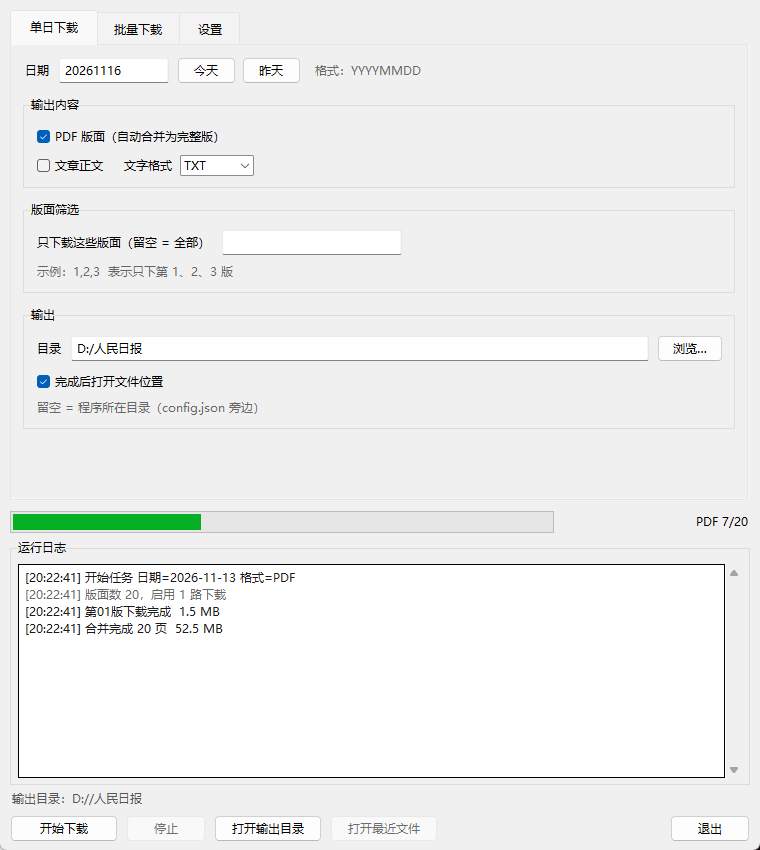
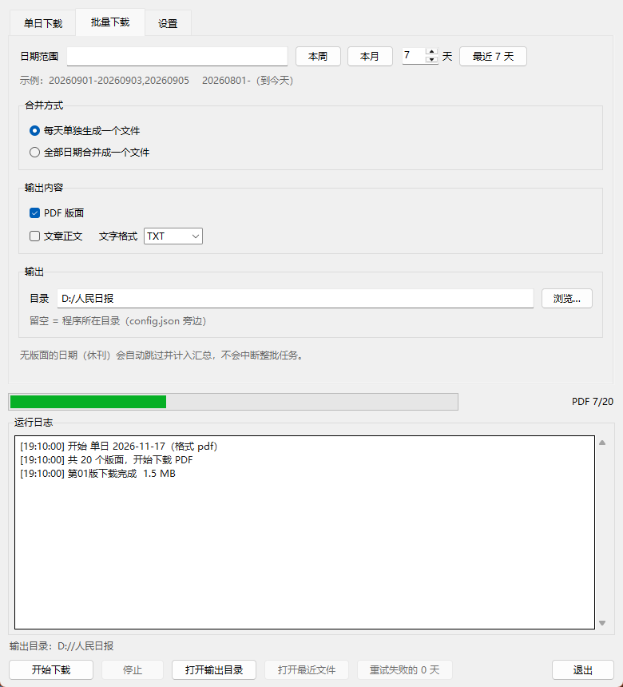

# 人民日报电子版下载器 / People's Daily Downloader

> 中文 | [English](docs/README_EN.md) | [日本語](docs/README_JA.md) | [한국어](docs/README_KO.md) | [Français](docs/README_FR.md) | [Deutsch](docs/README_DE.md) | [Italiano](docs/README_IT.md) | [हिन्दी](docs/README_HI.md) | [ไทย](docs/README_TH.md) | [العربية](docs/README_AR.md) | [Русский](docs/README_RU.md) | [Español](docs/README_ES.md)

[](https://www.python.org/)
[]()
[]()
[]()

一个纯 Python 编写的《人民日报》电子版下载工具：下载当日全部版面 PDF 并合并、抓取文章正文、
按日期批量下载，带 **Windows 原生图形界面** 和命令行两种用法。**零第三方依赖**——PDF 合并由内置的
标准库实现，不需要 `pip install` 任何东西。



---

## 功能

| 功能 | 说明 |
|---|---|
| **图形界面** | tkinter/ttk 原生控件（vista 主题），三个页签：单日下载 / 批量下载 / 设置 |
| **PDF 模式** | 下载当日全部版面 PDF，按版序合并为一个完整版文件 |
| **文字模式** | 抓取全部版面文章正文，输出 `TXT` / `MD` / `DOC` / `DOCX` |
| **批量下载** | 日期范围表达式，可"每天一个文件"或"全部合并成一个大文件" |
| **版面筛选** | 只下载指定版面（如只下第 1、2 版） |
| **断点续跑** | `skip_existing` 跳过已下载的版面，中断后重跑不会重复下载 |
| **全配置化** | 网络、代理、限速、并发、输出、日志、调度全部集中在 `config.json` |
| **零依赖** | 只用标准库；`pypdf` 仅作为处理特殊 PDF 时的可选回退 |
| **健壮性** | 网络重试、中文友好报错、日志轮转、配置原子写入、删除边界保护 |

---

## 环境要求

| 项目 | 要求 |
|---|---|
| 操作系统 | Windows 10 / 11（图形界面依赖 Windows 自带的 Tk；核心脚本本身跨平台） |
| Python | **3.8 及以上**，需包含 `tkinter`（python.org 官方安装包默认包含） |
| 第三方库 | **无**（`pypdf` 可选，仅在遇到不支持的 PDF 结构时才需要） |
| 网络 | 需能访问 `paper.people.com.cn` |
| 浏览器 | **不需要** Chrome / Edge 或任何驱动 |

> 命令行模式在 Linux / macOS 上同样可用（图形界面为 Windows 版）。

---

## 快速开始

### 方式一：双击启动（推荐）

1. 确保 `下载人民日报.bat`、`config.json`、`*.py` 在同一个文件夹
2. 双击 **`下载人民日报.bat`** → 直接打开图形界面
3. 选日期、勾选输出内容，点「开始下载」

需要原来的命令行菜单，用 `下载人民日报.bat --cli`。

### 方式二：直接运行

```bash
python rmrb_ui.py           # 图形界面
python rmrb_downloader.py   # 命令行交互菜单
```

### 方式三：命令行单次执行

```bash
# 下载今日全部版面 PDF 并合并
python rmrb_downloader.py

# 指定日期 + 格式
python rmrb_downloader.py 20260903 pdf
python rmrb_downloader.py 20260903 text
python rmrb_downloader.py 20260903 both

# 输出 Markdown
python rmrb_downloader.py 20260903 text --text-format MD

# 批量：每天单独合并
python rmrb_downloader.py --batch "20260901-20260903" pdf --merge-mode each

# 批量：全部合并成一个跨日期大文件
python rmrb_downloader.py --batch "20260901-20260903,20260905" both --merge-mode all

# 从某日期到今日
python rmrb_downloader.py --batch "20260801-" pdf

# 极速（间隔 0 + 8 并发，注意对官网的压力）
python rmrb_downloader.py 20260903 pdf --interval 0 --concurrent 8

# 其他
python rmrb_downloader.py --init            # 生成/刷新 config.json
python rmrb_downloader.py --task-install    # 注册每日自动下载计划任务
python rmrb_downloader.py --task-remove     # 删除计划任务
python rmrb_downloader.py -h                # 查看全部参数
```

---

## 图形界面

| 页签 | 内容 |
|---|---|
| **单日下载** | 日期（今天/昨天快捷键）、输出内容（PDF / 正文 + 文字格式）、版面筛选、输出目录 |
| **批量下载** | 日期范围（本周/本月快捷键）、合并方式、输出内容、输出目录 |
| **设置** | 超时、重试、PDF 并发、正文并发、限速、代理、保留单版、跳过已下载、PDF 引擎、日志级别 |

- 自动跟随系统 DPI 与「文本大小」设置（125% / 150% 缩放下不会变小或发虚）
- 下载在后台线程执行，界面不卡顿，可随时点「停止」
- 日志按级别着色，完成后自动在资源管理器中定位文件
- 界面里的修改与 `config.json` 是同一份配置，命令行和图形界面互通



---

## 配置说明（config.json）

首次运行自动生成。改坏了也会自动备份为 `config.json.bad` 并回退默认值。

### 抓取与网络

| 键 | 默认值 | 说明 |
|---|---|---|
| `base_url` | `http://paper.people.com.cn/rmrb/pc` | 电子版基础地址 |
| `rate_limit_kbps` | `0` | 下载限速（KB/s），`0` = 不限 |
| `timeout` | `30` | 单次请求超时（秒） |
| `retry` | `3` | 失败重试次数 |
| `retry_interval` | `2` | 重试间隔（秒） |
| `request_interval` | `0.05` | 请求间隔（秒），并发时也生效；`0` = 极速 |
| `concurrent` | `6` | PDF 并发数（1–16） |
| `proxy` | `""` | HTTP/HTTPS 代理，如 `http://127.0.0.1:7890` |
| `user_agent` | Chrome UA | 请求 User-Agent |

### 界面

| 键 | 默认值 | 说明 |
|---|---|---|
| `show_progress` | `true` | 命令行是否显示进度 |
| `color_foreground` / `color_background` | `"A"` / `"0"` | 控制台配色（两位十六进制） |
| `window_title` | `人民日报电子版下载器` | 控制台窗口标题 |

### 日期与内容

| 键 | 默认值 | 说明 |
|---|---|---|
| `default_date` | `""` | 默认日期，空 = 今天 |
| `default_format` | `"pdf"` | `pdf` / `text` / `both` |
| `edition_filter` | `[]` | 版面白名单，如 `[1,2]`；空 = 全部 |
| `holiday_skip` | `false` | 无版面日期是否静默跳过 |

### 输出与合并

| 键 | 默认值 | 说明 |
|---|---|---|
| `download_path` | `""` | 下载根目录，空 = 程序所在目录 |
| `download_dir` | `"pdfs_{date}"` | 单版 PDF 子目录模板（必须是相对路径） |
| `merged_filename` | `"人民日报-{date}-完整版"` | 合并后文件名模板（不含扩展名） |
| `auto_merge` | `true` | 下载完是否自动合并 |
| `keep_singles` | `true` | 合并后是否保留单版目录 |
| `open_folder_after` | `true` | 完成后是否打开文件位置 |
| `skip_existing` | `false` | 跳过已存在的单版 PDF |
| `pdf_engine` | `"auto"` | `auto` / `builtin` / `pypdf` |

### 文字输出

| 键 | 默认值 | 说明 |
|---|---|---|
| `text_output_format` | `"TXT"` | `TXT` / `MD` / `DOC` / `DOCX` |
| `text_filename` | `"人民日报-{date}-文字版"` | 文字版文件名模板 |
| `text_include_edition` | `true` | 是否包含版面标题 |
| `text_concurrent` | `6` | 正文抓取并发（1 = 顺序） |

### 日志与调度

| 键 | 默认值 | 说明 |
|---|---|---|
| `log_file` | `"rmrb_download.log"` | 日志文件，空 = 不记日志 |
| `log_level` | `"normal"` | `quiet` / `normal` / `debug` |
| `log_max_kb` | `512` | 日志超过该大小自动轮转一次 |
| `beep_on_done` | `false` | 完成时蜂鸣 |
| `msg_on_done` | `false` | 完成时弹消息框 |
| `auto_run` / `auto_run_time` | `false` / `"08:00"` | 配合 `--task-install` 每日自动下载 |

---

## 批量日期表达式

| 表达式 | 含义 |
|---|---|
| `20260901-20260903` | 2026-09-01 至 2026-09-03（含两端） |
| `20260905` | 单日 |
| `20260801-` | 从该日期到**今天** |
| `20260901-20260903,20260905` | 多段组合，自动去重排序 |
| `2026-09-01~2026-09-03` | 带分隔符的日期 + `~` 范围，也支持 |

非法日期（如 `20260134`）、起止颠倒、格式错误都会在下载前拦截并给出中文提示。


---

## 速度：到底是什么在限制你

实测（2026-11-13 全 20 版，52.5 MB，同一台机器同一时段）：

| 请求间隔 | 并发 | 耗时 | 速度 |
|---|---|---|---|
| 0.2 s（v2.0 的默认） | 4 | 16–19 s | 2.6–3.2 MB/s |
| **0.05 s（当前默认）** | **6** | **6.7 s** | **7.9 MB/s** |
| 0 s（极速） | 8 | 1.6–2 s | 26–33 MB/s |

结论：

- **瓶颈是"请求间隔"，不是带宽、也不是 CPU。** 每下载一个版面要发 2 个请求（版面页 + PDF），
  20 版 = 40 个请求；0.2 s 的间隔光排队就吃掉 8 秒。
- **多进程 / 多核没有意义。** 这是纯网络 I/O，Python 的 GIL 不拦 I/O，加进程只会多耗内存。
- 服务器**支持 Range 分片**（实测返回 206），单连接约 5 MB/s、多连接可以叠加到 30 MB/s；
  但不同版面本来就是并行下载的，再对单个文件切片收益很小（只有当某天只有一两个超大版面时才值得）。
- 服务器对持续高频请求会限流：连续压测 5 分钟后，同一配置只能跑出 4 MB/s。所以 0 间隔别日常用。

三档预设（界面「设置 → 下载速度」，或命令行 `--interval`）：

| 档位 | request_interval | 适合 |
|---|---|---|
| 礼貌 | `0.2` | 挂后台、每日自动下载 |
| **标准（默认）** | `0.05` | 日常手动下载 |
| 极速 | `0`（配 `--concurrent 8`） | 偶尔下一次，接受被限流的风险 |

```bash
python rmrb_downloader.py 20261113 pdf --interval 0 --concurrent 8
```

---

## 项目结构

```
renminribao-downloader/
├── rmrb_core.py          # 引擎：配置 / 网络 / 解析 / 输出 / 任务编排
├── rmrb_pdf.py           # 纯标准库 PDF 合并（经典 xref 表）
├── rmrb_downloader.py    # 命令行 + 交互式菜单
├── rmrb_ui.py            # 图形界面（tkinter/ttk）
├── tests/test_core.py    # 35 项离线单元测试
├── build_bat.py          # 生成 GBK 编码的 BAT 启动器
├── create_shortcut.ps1   # 创建桌面快捷方式（带图标）
├── config.json           # 配置文件（首次运行自动生成）
├── 人民日报下载器.ico     # 图标（16–256 多尺寸）
├── 下载人民日报.bat       # 双击启动器
├── icon_src.png          # 图标源图
└── docs/                 # 多语言说明与界面截图
```

---

## 测试

```bash
python -m unittest discover -s tests -v
```

35 项测试，**全部离线**，不访问网络：

- PDF 合并：多文档合并、页数/对象数校验、流对象保留、损坏文件与压缩 xref 的拒绝
- 文章解析：标题实体反转义、正文标记边界、标题回退、链接排序去重
- 日期表达式：范围、开区间、带分隔符、去重、非法输入
- 配置：原子写入、损坏回退、数值钳制、路径穿越拦截、枚举回退
- 删除保护：拒绝删除输出根目录本身与目录外路径
- 文字输出：TXT / MD / DOC / DOCX（校验 OOXML 结构与 XML 转义）

---

## 从源码打包 exe

```bat
pip install pyinstaller -i https://pypi.tuna.tsinghua.edu.cn/simple

pyinstaller --onefile --noconsole --name "人民日报下载器" ^
  --icon "人民日报下载器.ico" --add-data "人民日报下载器.ico;." ^
  --hidden-import rmrb_pdf --clean rmrb_ui.py
```

- 打包 `rmrb_ui.py` 得到无控制台的图形版；需要命令行版就把入口换成 `rmrb_downloader.py`，并去掉 `--noconsole`
- 产物在 `dist/人民日报下载器.exe`，复制到项目根目录即可（配置、下载目录都在 exe 同级）

---

## 这一版做了什么

相对于 v1.3.0（纯脚本 + 控制台菜单）：

**新增**
- Windows 原生图形界面（tkinter/ttk，不引第三方 UI 库）
- 引擎与界面分离（`rmrb_core` / `rmrb_downloader` / `rmrb_ui`），两种入口共用一套逻辑
- 纯标准库 PDF 合并（`rmrb_pdf`），不再需要 `pip install pypdf`；结构特殊时自动回退 pypdf
- Markdown 文字输出
- `skip_existing` 断点续跑
- 35 项离线单元测试

**性能（实测，2026-11-13 全 20 版）**

| 场景 | v1.3.0 | v2.0.0 | v2.1.0 |
|---|---|---|---|
| 20 版 PDF 下载并合并（52.5 MB） | 约 70 秒 | 16 秒 | **6.7 秒** |
| 20 版正文抓取（1509 行 / 354 KB） | 约 100 秒 | 22 秒 | **8.9 秒** |
| 不存在的日期（404） | 重试 3 次，约 6 秒 | 0.06 秒 | 0.06 秒 |

靠三件事做到：

- **连接复用**：HTTP 请求改用 `http.client` 长连接（urllib 每个请求都要重新握手），
  实测单次请求开销从 ~0.3 秒降到 0.2 秒（已接近请求间隔本身）
- **默认并发 4**：`concurrent` / `text_concurrent` 默认值提高到 4，配合全局节流器
  （`request_interval` 仍然强制生效，不会对官网造成突发压力）
- **版面页缓存**：PDF 与文字模式共用同一份版面 HTML，单日 PDF+文字少约 20 次请求
- **4xx 不重试**：404/403 属于永久错误，立即报错而不是白等 3 次重试

**修复**
- `log_file` / `log_level` 此前完全不生效（文件名写死、`quiet` 不静默）
- 文章标题未做 HTML 实体反转义（`&amp;` 直接进正文）
- `schtasks` 参数用 `\"` 转义，cmd.exe 不认，计划任务会注册失败
- `config.json` 非原子写入，断电即损坏；现在写临时文件再替换
- 菜单里"恢复默认配置"只写了文件，当前会话不生效
- 无论配置如何都提示"文件位置已自动打开"
- 并发下载时多线程进度条互相覆盖
- 在 Windows Terminal / VS Code（UTF-8）里强制转 GBK 导致中文乱码

**安全加固**
- `download_dir`、`merged_filename`、`text_filename` 校验：拒绝绝对路径、盘符、`..`
- 合并后清理单版目录前先做边界检查，**绝不会删除输出根目录或目录之外的路径**
  （此前把 `download_dir` 设为空串 + `keep_singles:false`，会把整个输出目录连同刚合并的 PDF 一起删掉）

### v2.1.0

- 默认请求间隔 0.2 s → **0.05 s**、并发 4 → **6**：整日 20 版从 16 s 降到 **6.7 s**
- 新增 `--interval` 参数与界面「下载速度」三档（礼貌 / 标准 / 极速）
- 校正配置回退的默认值（此前回退到写死的 1，而不是当前默认）
- 文档补充实测数据与"为什么加进程没用"的说明

---

## 免责声明

- 本工具仅供个人学习与研究使用，不得用于任何商业活动。
- 《人民日报》版权归人民日报社所有，下载内容请遵守相关法律法规与网站使用条款。
- 请合理控制访问频率（`request_interval`），避免对官网造成压力。
- 官网结构若发生变化，本工具可能需要相应调整。

## License

MIT
