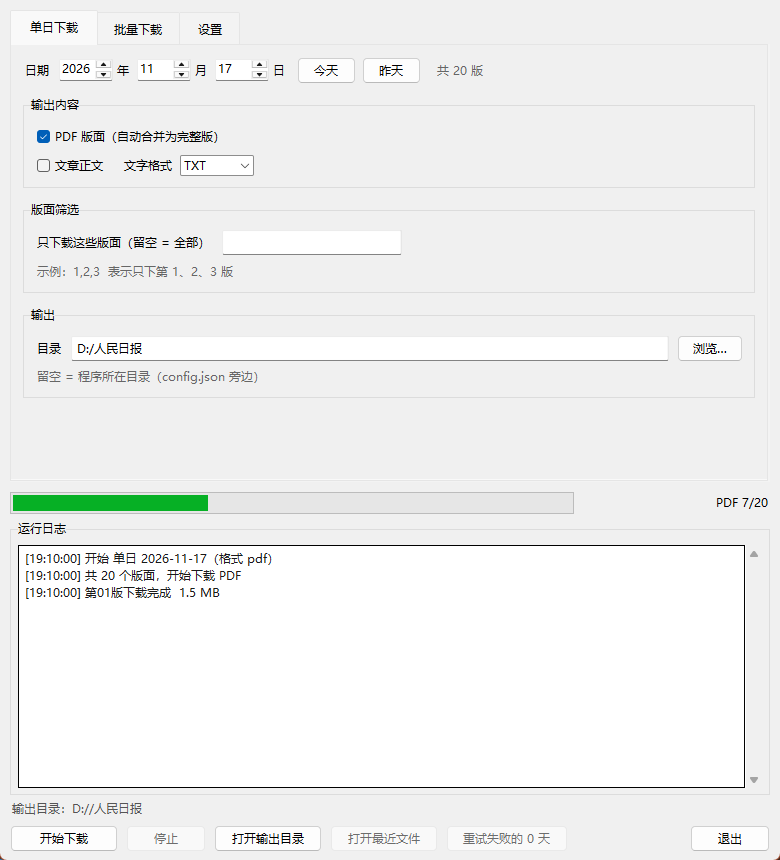
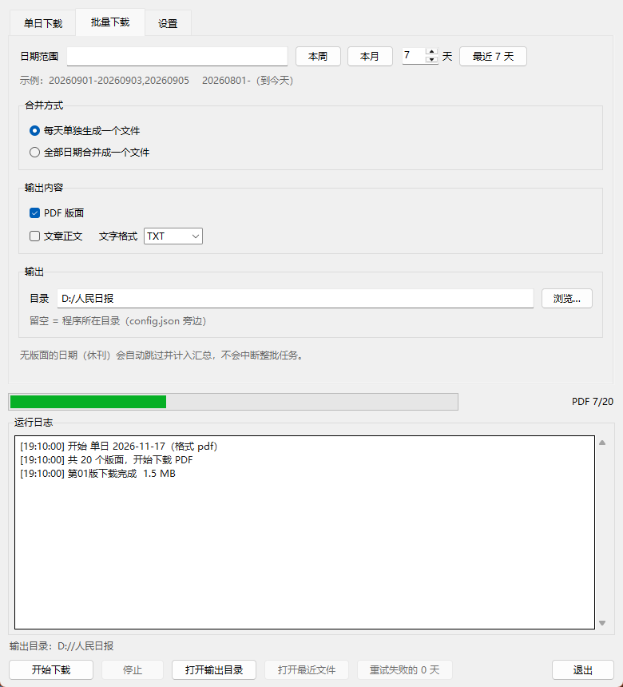

# People's Daily Downloader / 人民日报电子版下载器

> [中文](../README.md) | English | [日本語](README_JA.md) | [한국어](README_KO.md) | [Français](README_FR.md) | [Deutsch](README_DE.md) | [Italiano](README_IT.md) | [हिन्दी](README_HI.md) | [ไทย](README_TH.md) | [العربية](README_AR.md) | [Русский](README_RU.md) | [Español](README_ES.md)

[](https://www.python.org/)
[]()
[]()
[]()

[](https://github.com/zfy273/renminribao-downloader/actions/workflows/tests.yml)

A pure-Python tool that downloads the electronic edition of **People's Daily (人民日报)**: fetch and
merge every page PDF of a day, extract article text, and download date ranges in batch — available as a
**native Windows GUI** and as a command-line tool. **No third-party dependencies**: PDF merging is done
by a built-in standard-library implementation, so nothing needs to be `pip install`ed.



---

## Features

| Feature | Details |
|---|---|
| **Native GUI** | tkinter/ttk with the Windows `vista` theme; tabs for single day / batch / settings |
| **PDF mode** | Download all page PDFs of a day and merge them in page order |
| **Text mode** | Extract article bodies, output `TXT` / `MD` / `DOC` / `DOCX` |
| **Batch mode** | Date-range expressions; one file per day, or everything merged into one file |
| **Edition filter** | Only download selected page numbers (e.g. pages 1 and 2) |
| **Resume** | After a stop or crash, only the missing pages are downloaded |
| **Retry failures** | Failed dates are listed and written to disk; one click retries just those days |
| **Segmented download** | When a day has very few pages, one PDF is split into 4 Range requests (+61% per file) |
| **Fully configurable** | Network, proxy, rate limit, concurrency, output, logging, scheduling in `config.json` |
| **Zero dependencies** | Standard library only; `pypdf` is an optional fallback for exotic PDFs |
| **Robust** | Retries, Chinese-friendly error messages, log rotation, atomic config writes, delete guards |

---

## Requirements

| Item | Requirement |
|---|---|
| OS | Windows 10 / 11 (the GUI uses the bundled Tk; the engine itself is cross-platform) |
| Python | **3.8+** with `tkinter` (included in the official python.org installer) |
| Third-party | **None** (`pypdf` optional, only for PDFs the built-in engine rejects) |
| Network | Access to `paper.people.com.cn` |
| Browser | **Not needed** — no Chrome/Edge, no webdriver |

> The CLI works on Linux and macOS too; the GUI is Windows-focused.

---

## Quick start

### 1. Double-click launcher (recommended)

1. Keep `下载人民日报.bat`, `config.json` and the `*.py` files in the same folder
2. Double-click **`下载人民日报.bat`** — the GUI opens
3. Pick a date, tick what you want, click **开始下载**

For the classic console menu run `下载人民日报.bat --cli`.

### 2. Run directly

```bash
python rmrb_ui.py           # GUI
python rmrb_downloader.py   # interactive console menu
```

### 3. One-shot CLI

```bash
# Today, all pages, merged into one PDF
python rmrb_downloader.py

# Specific date and format
python rmrb_downloader.py 20260903 pdf
python rmrb_downloader.py 20260903 text
python rmrb_downloader.py 20260903 both

# Markdown output
python rmrb_downloader.py 20260903 text --text-format MD

# Batch: one merged file per day
python rmrb_downloader.py --batch "20260901-20260903" pdf --merge-mode each

# Batch: merge everything into one cross-date file
python rmrb_downloader.py --batch "20260901-20260903,20260905" both --merge-mode all

# From a date up to today
python rmrb_downloader.py --batch "20260801-" pdf

# Flat out (zero interval, 8 connections — be considerate)
python rmrb_downloader.py 20260903 pdf --interval 0 --concurrent 8

# Misc
python rmrb_downloader.py --init            # create/refresh config.json
python rmrb_downloader.py --task-install    # register a daily task (it calls the tool with --silent)
python rmrb_downloader.py --task-remove     # remove the scheduled task
python rmrb_downloader.py -h                # all options
```

---

## GUI

| Tab | Contents |
|---|---|
| **Single day** | Date (today/yesterday shortcuts), output (PDF / text + text format), edition filter, output folder |
| **Batch** | Date range (this week/month shortcuts), merge mode, output, output folder |
| **Settings** | Timeout, retries, PDF concurrency, text concurrency, rate limit, proxy, keep singles, skip existing, PDF engine, log level |

- Follows the system DPI and Windows "text size" setting (no shrinking or blur at 125%/150%)
- Downloads run on a worker thread; the window stays responsive and **停止** cancels the job
- Log lines are colour-coded by level; the finished file is revealed in Explorer
- The GUI and the CLI share the very same `config.json`



---

## Configuration (`config.json`)

Created on first run. A broken file is backed up as `config.json.bad` and defaults are used.

### Network

| Key | Default | Description |
|---|---|---|
| `base_url` | `http://paper.people.com.cn/rmrb/pc` | Base URL of the electronic edition |
| `rate_limit_kbps` | `0` | Download rate limit in KB/s, `0` = unlimited |
| `timeout` | `30` | Per-request timeout (seconds) |
| `retry` | `3` | Retry count |
| `retry_interval` | `2` | Seconds between retries |
| `request_interval` | `0.05` | Seconds between requests; `0` = flat out |
| `concurrent` | `6` | PDF concurrency (1–16) |
| `proxy` | `""` | HTTP/HTTPS proxy, e.g. `http://127.0.0.1:7890` |
| `user_agent` | Chrome UA | Request User-Agent |

### Interface

| Key | Default | Description |
|---|---|---|
| `show_progress` | `true` | Show progress in the CLI |
| `color_foreground` / `color_background` | `"A"` / `"0"` | Console colours (two hex digits) |
| `window_title` | `人民日报电子版下载器` | Console window title |

### Date and content

| Key | Default | Description |
|---|---|---|
| `default_date` | `""` | Default date, empty = today |
| `default_format` | `"pdf"` | `pdf` / `text` / `both` |
| `edition_filter` | `[]` | Whitelist of page numbers, e.g. `[1,2]`; empty = all |
| `holiday_skip` | `false` | Silently skip days without any page |

### Output and merging

| Key | Default | Description |
|---|---|---|
| `download_path` | `""` | Output root, empty = the program folder |
| `download_dir` | `"pdfs_{date}"` | Sub-folder template for single PDFs (must be relative) |
| `merged_filename` | `"人民日报-{date}-完整版"` | Merged file name template (no extension) |
| `auto_merge` | `true` | Merge automatically after downloading |
| `keep_singles` | `true` | Keep the single-page folder after merging |
| `open_folder_after` | `false` | Reveal the output when finished (off by default; the GUI has an "open" button) |
| `skip_existing` | `false` | Skip single PDFs that already exist |
| `pdf_engine` | `"auto"` | `auto` / `builtin` / `pypdf` |
| `split` | `0` | Segments per file: `0`=auto (4 when ≤3 pages), `1`=off, `2–8`=fixed |

### Text output

| Key | Default | Description |
|---|---|---|
| `text_output_format` | `"TXT"` | `TXT` / `MD` / `DOC` / `DOCX` |
| `text_filename` | `"人民日报-{date}-文字版"` | Text file name template |
| `text_include_edition` | `true` | Include page headings |
| `text_concurrent` | `6` | Article fetch concurrency (1 = sequential) |

### Logging and scheduling

| Key | Default | Description |
|---|---|---|
| `log_file` | `"rmrb_download.log"` | Log file, empty = no log |
| `log_level` | `"normal"` | `quiet` / `normal` / `debug` |
| `log_max_kb` | `512` | Rotate the log once it exceeds this size |
| `beep_on_done` | `false` | Beep when finished |
| `msg_on_done` | `false` | Show a message box when finished |
| `auto_run` / `auto_run_time` | `false` / `"08:00"` | Used by `--task-install` |

---

## Keyboard shortcuts

| Key | Action |
|---|---|
| `Enter` (in a date field) / `Ctrl+Enter` | Start |
| `Esc` | Stop (only while running) |
| `Ctrl+O` | Open the output folder |
| `Ctrl+S` | Save settings |
| `F1` | Open the README |

The date is entered as three fields (year / month / day); changing the month clamps the day, so
February can never show the 31st. The header also shows "共 N 版" before you start.
The batch tab has 本周 / 本月 / 最近 N 天 shortcuts, with N editable (1–365).

---

## Batch date expressions

| Expression | Meaning |
|---|---|
| `20260901-20260903` | 2026-09-01 through 2026-09-03 (inclusive) |
| `20260905` | A single day |
| `20260801-` | From that date **until today** |
| `20260901-20260903,20260905` | Multiple segments, de-duplicated and sorted |
| `2026-09-01~2026-09-03` | Dashed dates with a `~` range also work |

Invalid dates (e.g. `20260134`), reversed ranges and malformed input are rejected before any download.


---

## Speed: what actually limits you

Measured on a full 20-page issue (52.5 MB), same machine, same hour:

| Request interval | Concurrency | Time | Throughput |
|---|---|---|---|
| 0.2 s (v2.0 default) | 4 | 16–19 s | 2.6–3.2 MB/s |
| **0.05 s (current default)** | **6** | **6.7 s** | **7.9 MB/s** |
| 0 s (flat out) | 8 | 1.6–2 s | 26–33 MB/s |

What this means:

- **The bottleneck is the request interval, not bandwidth and not CPU.** Each edition needs two
  requests (page + PDF); 20 editions = 40 requests, and a 0.2 s gap alone costs 8 seconds.
- **More processes or cores will not help.** This is pure network I/O; the GIL does not block I/O.
- The server **does support Range requests** (206 observed): one connection tops out around 5 MB/s
  and several connections add up to ~30 MB/s. But editions are already downloaded in parallel, so
  splitting a single file adds little — only worth it when a day has one or two huge pages.
- The server throttles sustained load: after five minutes of hammering, the same settings dropped to
  4 MB/s. So do not use a zero interval as your daily driver.

### Segmented download (only pays off when a day has few pages)

The server supports `Range` (206 observed). On days with 1–3 pages a single connection cannot fill
the link, so splitting one PDF into four parallel requests helps (same 5.9 MB file, 4 rounds):

| Mode | Average |
|---|---|
| Single connection | 5.14 MB/s |
| **4 segments** | **8.29 MB/s (+61%)** |
| 8 segments | 7.33 MB/s (no further gain) |

A normal 20-page day does not need it (pages are already fetched in parallel), so the default is
**auto**: 4 segments when ≤3 pages, single connection otherwise. Force it with `--split 4`, disable
with `--split 1`.

> Segmentation gains swing with server load: the same configuration measured between 0.5 s and 2.4 s.
> The table above aggregates four rounds.

Three presets (GUI: Settings → 下载速度, or CLI `--interval`):

| Preset | request_interval | When |
|---|---|---|
| Polite | `0.2` | background / scheduled daily runs |
| **Standard (default)** | `0.05` | everyday manual downloads |
| Flat out | `0` (with `--concurrent 8`) | one-off, accepting the throttling risk |

```bash
python rmrb_downloader.py 20261113 pdf --interval 0 --concurrent 8
```

---

## Project layout

```
renminribao-downloader/
├── rmrb_core.py          # engine: config / network / parsing / output / orchestration
├── rmrb_pdf.py           # dependency-free PDF merger (classic xref tables)
├── rmrb_downloader.py    # CLI + interactive menu
├── rmrb_ui.py            # GUI (tkinter/ttk)
├── tests/test_core.py    # 35 offline unit tests
├── build_bat.py          # generates the GBK-encoded .bat launcher
├── create_shortcut.ps1   # creates desktop shortcuts (with icon)
├── config.json           # configuration (auto-created)
├── 人民日报下载器.ico     # icon, 16–256 px
├── 下载人民日报.bat       # double-click launcher
├── icon_src.png          # icon source image
└── docs/                 # translations and screenshots
```

---

## Tests

```bash
python -m unittest discover -s tests -v
```

35 tests, **completely offline**:

- PDF merging: multi-document merge, page/object counts, stream preservation, rejection of broken
  files and of compressed cross-reference PDFs
- Article parsing: title entity unescaping, content markers, title fallback, link ordering
- Date expressions: ranges, open ranges, dashed dates, de-duplication, invalid input
- Config: atomic write, corrupt-file fallback, clamping, path-traversal rejection, enum fallback
- Delete guard: refuses to remove the output root itself or anything outside it
- Text output: TXT / MD / DOC / DOCX (OOXML structure and XML escaping)

---

## Build a standalone exe

```bat
pip install pyinstaller -i https://pypi.tuna.tsinghua.edu.cn/simple

pyinstaller --onefile --noconsole --name "人民日报下载器" ^
  --icon "人民日报下载器.ico" --add-data "人民日报下载器.ico;." ^
  --hidden-import rmrb_pdf --clean rmrb_ui.py
```

- Building `rmrb_ui.py` produces a console-less GUI build; for a CLI build use `rmrb_downloader.py`
  and drop `--noconsole`
- The binary lands in `dist/`; copy it next to `config.json` (config and downloads live beside the exe)

---

## What changed in this version

Compared to v1.3.0 (single script + console menu):

**Added**
- Native Windows GUI (tkinter/ttk, no third-party UI toolkit)
- Engine/UI split (`rmrb_core` / `rmrb_downloader` / `rmrb_ui`) sharing one code path
- Dependency-free PDF merging (`rmrb_pdf`); `pip install pypdf` is no longer required, and pypdf is
  still used automatically as a fallback for PDFs the built-in engine cannot handle
- Markdown text output
- `skip_existing` resume support
- 35 offline unit tests

**Performance (measured on a full 20-page issue, 2026-11-13)**

| Scenario | v1.3.0 | v2.0.0 | v2.1.0 |
|---|---|---|---|
| Download + merge 20 page PDFs (52.5 MB) | ~70 s | 16 s | **6.7 s** |
| Fetch text of all 20 pages (1509 lines / 354 KB) | ~100 s | 22 s | **8.9 s** |
| A date that does not exist (404) | 3 retries, ~6 s | 0.06 s | 0.06 s |

How:

- **Connection reuse**: requests go through a keep-alive `http.client` connection (urllib
  re-handshakes on every request); measured per-request overhead dropped from ~0.3 s to 0.2 s
- **Concurrency 4 by default**: `concurrent` / `text_concurrent` now default to 4, still bounded
  by the global pacer (`request_interval` keeps the request rate polite)
- **Page HTML cache** shared by PDF and text mode (~20 fewer requests per day)
- **No retry on 4xx**: 404/403 are permanent, so the tool fails fast instead of waiting through retries

**Fixes**
- `log_file` / `log_level` were ignored entirely (hard-coded file name, `quiet` did nothing)
- Article titles were not HTML-unescaped (`&amp;` leaked into the text)
- `schtasks` arguments used `\"` escaping that cmd.exe does not understand, so scheduled tasks failed
- `config.json` was written non-atomically and could be corrupted by a crash
- "Restore defaults" in the menu did not affect the running session
- "File location opened" was printed regardless of configuration
- Concurrent downloads overwrote each other's progress line
- Forcing a GBK stdout broke Chinese output in Windows Terminal / VS Code (UTF-8)

**Hardening**
- `download_dir`, `merged_filename` and `text_filename` are validated: absolute paths, drive letters
  and `..` are rejected
- The single-page folder is deleted only after a boundary check — **never the output root or anything
  outside it** (previously `download_dir: ""` plus `keep_singles: false` deleted the whole output
  folder together with the freshly merged PDF)

### v2.3.0

A behaviour-only release — nothing visual changed:

- **Three-field date input** (year/month/day) with month-aware day clamping
- **"Last N days"** shortcut in the batch tab (N editable, 1–365)
- **Shortcuts**: Enter to start, Esc to stop, Ctrl+O folder, Ctrl+S save, F1 help
- **Stop takes effect immediately** (checked every 256 KB instead of after the current file)
- **Stopping no longer wastes work**: finished pages are recorded in `.done`, so a re-run only
  fetches what is missing
- **Retry failures**: failed dates go to `failed-xxx.txt` and the GUI offers "retry N days"
- **No focus stealing**: finished downloads no longer pop Explorer; there is an "open" button
- **Log is appended, not cleared**, capped at 2000 lines
- **Instant feedback on start** plus an automatic "N pages today" probe
- **Proxy auto-prefixes `http://`**
- **"Restore defaults"** button in settings
- **Window height adapts to the screen**

### v2.2.1

- **Fixed: the scheduled task only opened a window instead of downloading in the exe build**
  (the task target had no arguments; it now runs `人民日报下载器.exe --silent <date> <format>`)
- New `--silent`: no output, no dialogs, no Explorer, log only — meant for scheduled tasks
- New GitHub Actions workflow: 39 offline tests on Windows + Linux across Python 3.9/3.12/3.13

### v2.2.0

- **HTTP Range segmented download**: 4 parallel requests when a day has ≤3 pages, 5.14 → 8.29 MB/s per file (4-round average)
- New `--split N` flag and a "分片" selector in the GUI (auto / off / 2 / 4 / 8)
- Choosing a speed preset now also sets the matching concurrency (polite 4 / standard 6 / flat out 8)
- Read buffer raised from 64 KB to 256 KB

### v2.1.0

- Default request interval 0.2 s → **0.05 s**, concurrency 4 → **6**: a full issue went from 16 s to **6.7 s**
- New `--interval` flag and a three-level speed selector in the GUI (polite / standard / flat out)
- Config fallbacks now use the real defaults instead of a hard-coded 1
- README documents the measurements and why extra processes do not help

---

## Disclaimer

- For personal study and research only. Commercial use is not allowed.
- People's Daily is copyrighted by the People's Daily Press. Respect the site's terms of service.
- Keep the request rate reasonable (`request_interval`) to avoid stressing the site.
- If the website structure changes, this tool may need updates.

## License

MIT
